# Week 3 - Password Cracking with JTR & NW Tools | Networkwalks

## Modules Completed
- W3-PM1: Password Cracking with JTR (John + Johnny)
- W3-PM2: Password Cracking with NW Tools (Hash Calculator + Password Cracker)
- 7.2.1: HexStrike MCP + Claude Desktop Setup on Kali Linux

## Method - PM1: JTR John + Johnny
1. Extracted $pdf$ hash from locked PDF
2. Saved hash as hash1.txt (format: $pdf$...)
3. Opened hash1.txt in Johnny GUI
4. Clicked "Open password file" > "Start new attack"
5. Johnny cracked 100% (1/1: 1 cracked, 0 left) [format=PDF]

## Method - PM2: Networkwalks Tools
1. Hash Calculator: https://networkwalks.com/hash-calculator/ - Uploaded locked PDF -> Got $pdf$ hash (R4 / 128-bit)
2. Password Cracker: https://networkwalks.com/password-cracker/ - Pasted $pdf$ hash - Used Built-in list (100 passwords)

## Results - Verified

### File 1: My Locked PDF1.pdf - password1
- Cracked Password: password1
- Tool 1: Johnny (JTR) - 100% cracked
- Tool 2: NW Password Cracker - Cracked at Tried: 91 / 100 - MATCH password1
- Verified: PDF opened
- Flag 1: nw{networkwalks_persistence_jtr_270521}
- Flag 2: nw{cybersecurity_flag_captured_2608}

### File 2: My Locked PDF3.pdf - 1qaz2wsx
- Cracked Password: 1qaz2wsx
- Tool 1: Johnny (JTR) - 100% cracked
- Tool 2: NW Password Cracker - Cracked at Tried: 35 / 100
- Verified: PDF opened
- Flag: nw{networkwalks_flag_260821_1}

### Important Finding - Wordlist Size Matters
- NW Password Cracker with built-in 100-word list on another hash: Tried: 100 / 100 -> Exhausted wordlist. No match. ACCESS DENIED
- Same type of hash cracked by JTR with larger wordlist.
- Lesson: Small wordlist = fail. Larger wordlist / right wordlist = success.

## HexStrike MCP Setup (7.2.1)
1. Installed Claude Desktop on Kali Linux (Claude for Linux)
2. Cloned: https://github.com/0x4m4/hexstrike-ai.git
3. Created venv: python3 -m venv hexstrike-env
4. Installed: pip3 install -r requirements.txt
5. Ran: python3 hexstrike_server.py
6. Verified: Server starting on 127.0.0.1:8888, 150+ modules active, Running on http://127.0.0.1:8888
7. MCP Config in Claude Desktop - command: /home/kali/hexstrike-ai/hexstrike-env/bin/python, args: /home/kali/hexstrike-ai/hexstrike_mcp.py --server http://localhost:8888

## HexStrike MCP In Action - Verified via Claude

### Test 1: Nmap Scan via HexStrike (Success)
- Tool: nmap via HexStrike MCP / Claude
- Target: scanme.nmap.org (45.33.32.156)
- Command: nmap -sV --top-ports 100
- Time: ~31 seconds
- Result: 3 ports open, 97 closed
- Port 22/tcp open ssh OpenSSH 6.6.1p1 Ubuntu 2ubuntu2.13
- Port 25/tcp open smtp? Not identified - 421 rate limit
- Port 80/tcp open http Apache httpd 2.4.7 (Ubuntu)
- OS: Linux (Ubuntu)
- IPv6: 2600:3c01::f03c:91ff:fe18:bb2f

### Test 2: Nmap Advanced / NSE Scan (Filtered - Honest Result)
- Tool: nmap_advanced_scan / NSE via HexStrike
- Result: No vulnerability findings - ports 22 and 80 returned filtered
- Latency dropped from 0.097s to 0.0013s - indicates firewall / rate-limit / local filtering
- Cause: Earlier scan likely triggered scanme rate-limit + -sT TCP connect scan is noisier than default
- Correct conclusion: Cannot confirm OpenSSH 6.6.1 / Apache 2.4.7 are vulnerable from version alone - version is not proof of exploitability.

## Screenshots
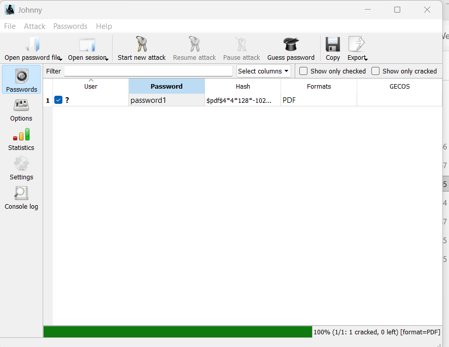
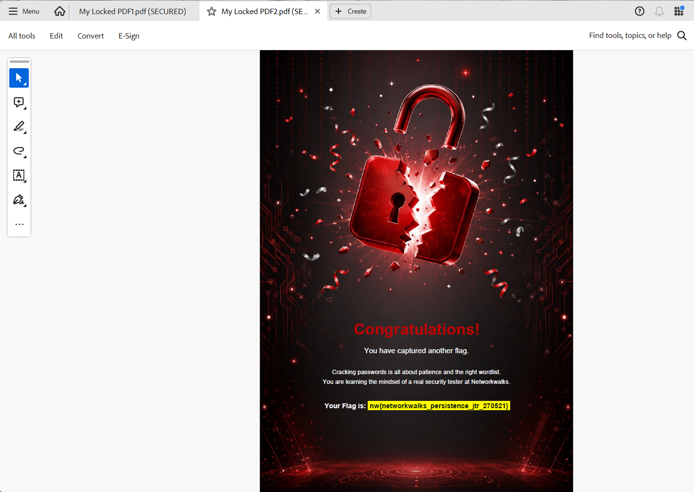
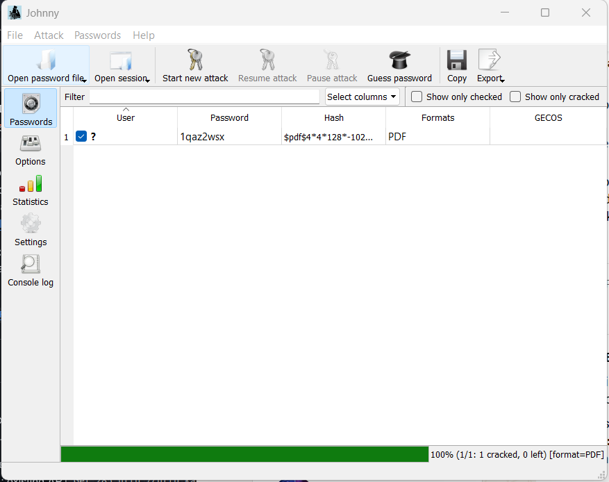
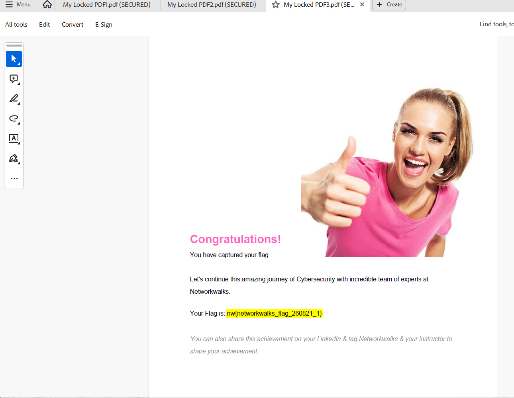
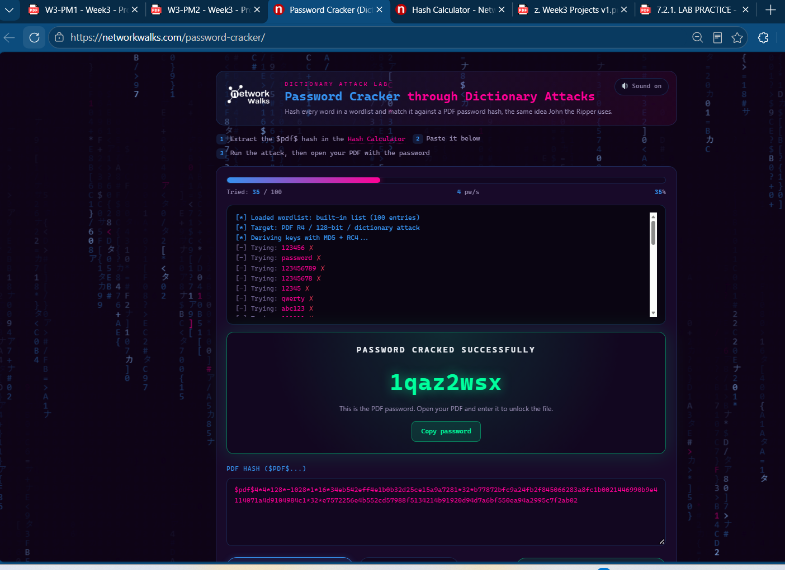
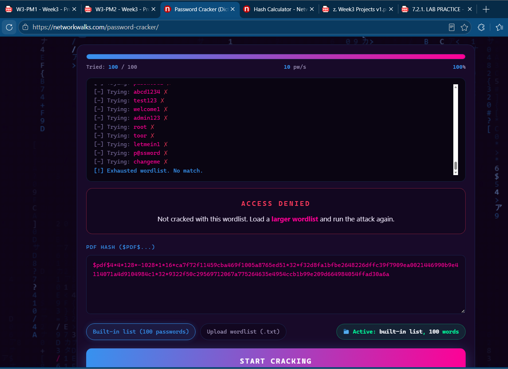
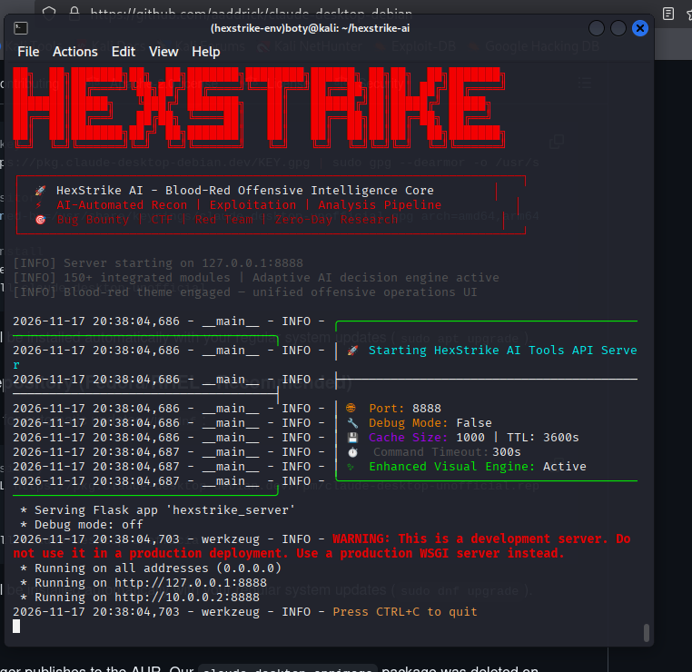
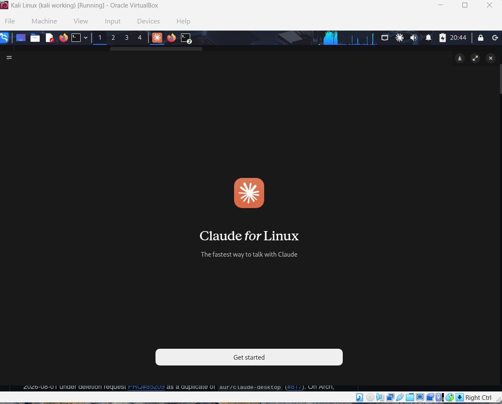
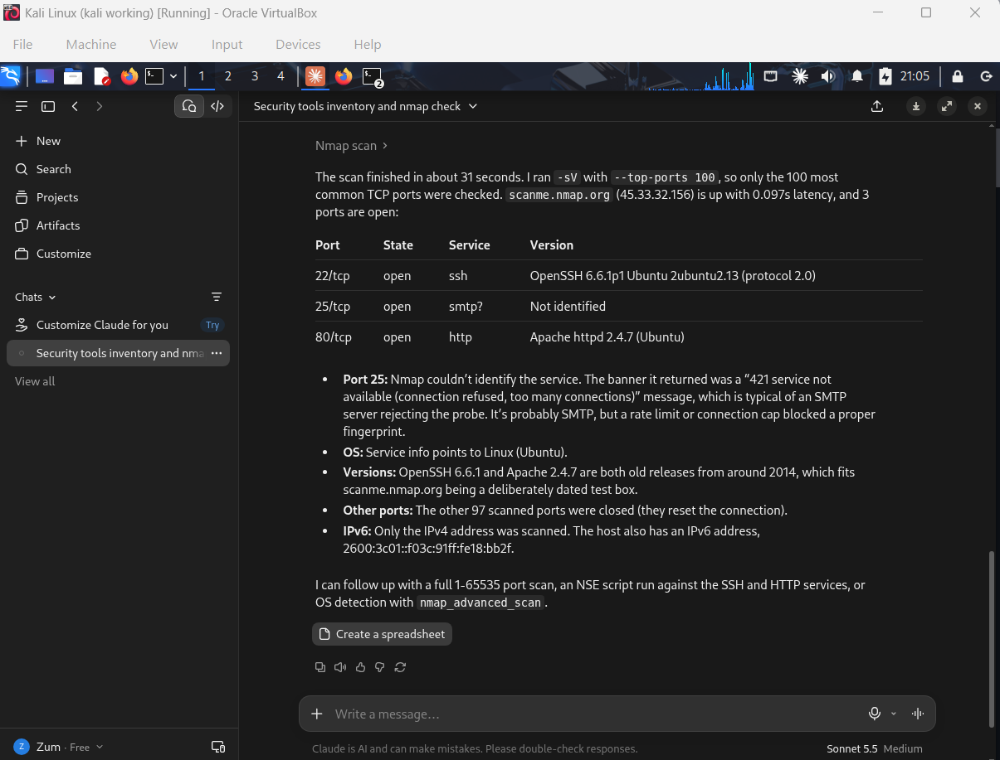
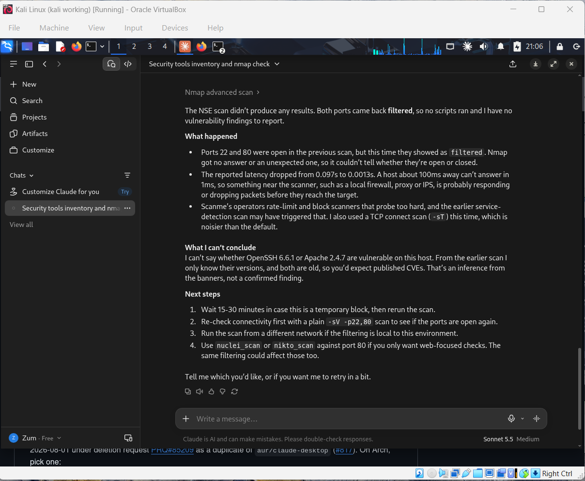
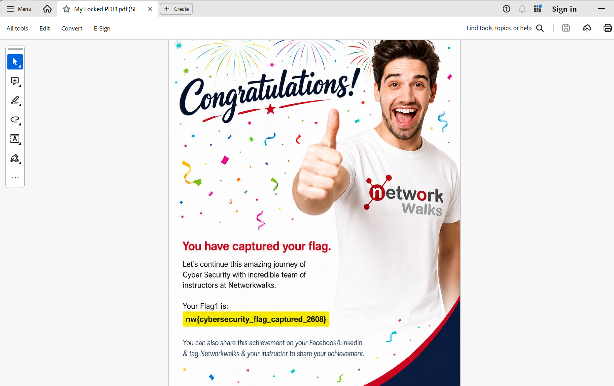
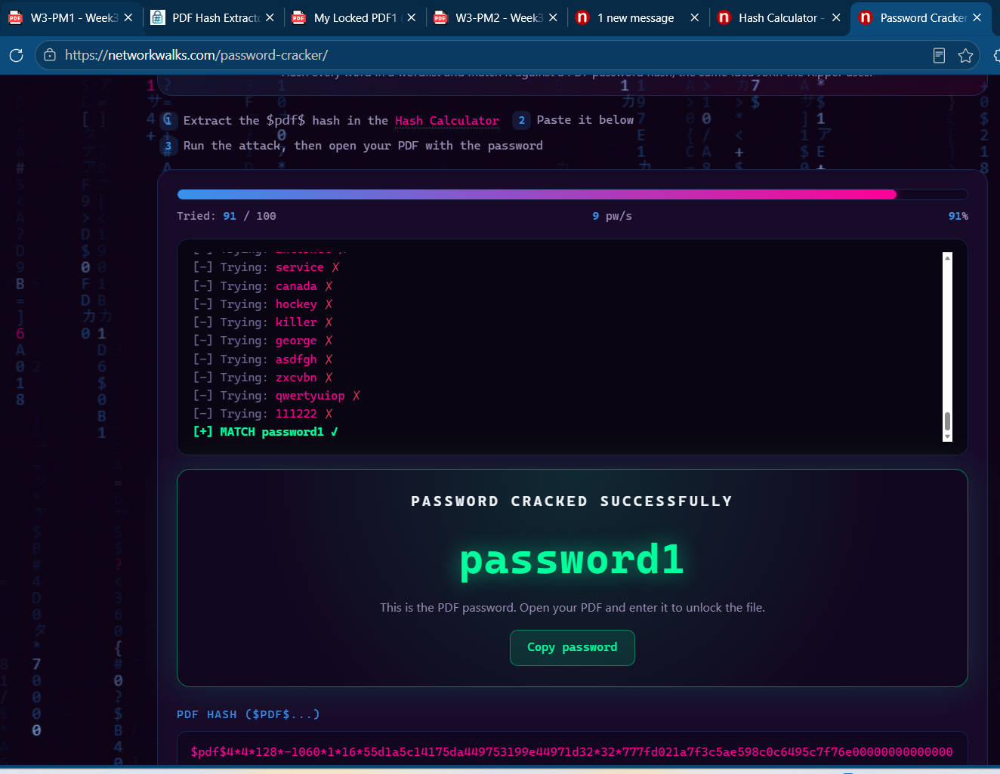

## Key Learning
- Hashing is one-way, encryption is two-way
- PDF password stored as $pdf$ hash - extract hash, then dictionary attack
- Weak passwords like password1 and 1qaz2wsx fall in minutes
- Defence: 12+ char mixed passwords + MFA + strong encryption

## Note
- W3-OPTIONAL1 skipped - target file hash3.networkwalks_flag1.pdf not provided in lab download / site / course folder.
